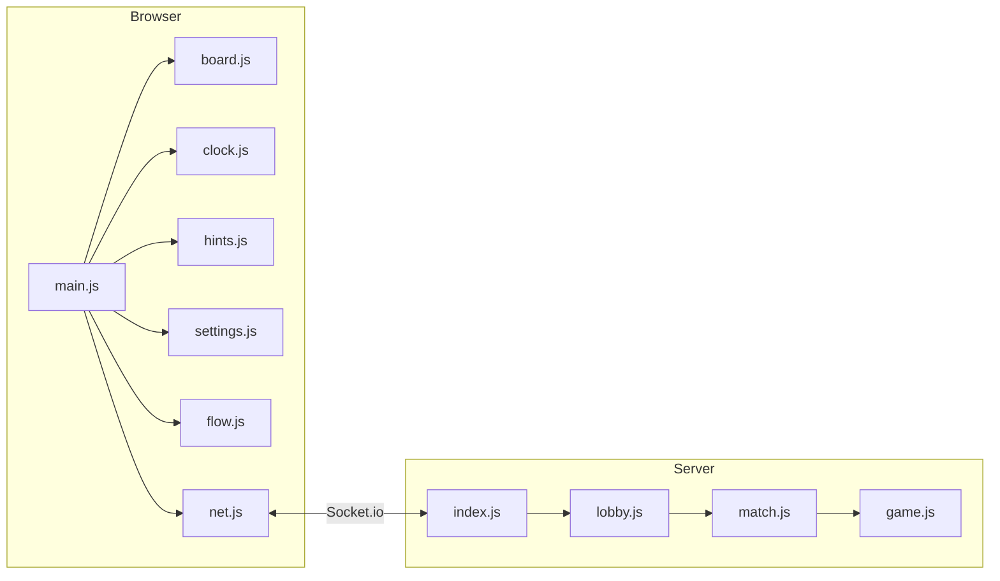
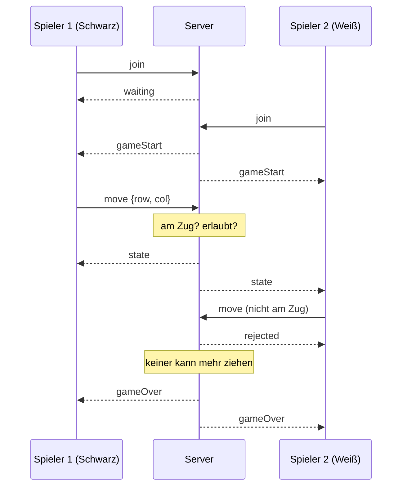

# Reversi

Reversi für zwei Spieler im Browser. Portfolioaufgabe WWI25EG Web-Entwicklung, DHBW Mannheim.

## Starten

Voraussetzung: Node.js 22 oder neuer.

```bash
npm install
npm run build
npm start -- 3000
```

Danach `http://localhost:3000` in zwei Browserfenstern öffnen.

- `npm run build` prüft nur, ob alle JavaScript-Dateien syntaktisch korrekt sind. Gebündelt wird nichts, der Browser lädt die Module direkt.
- Der Port kann auch über `PORT` gesetzt werden, die Bedenkzeit pro Zug über `TURN_SECONDS` (Standard: 60).
- Der Server lauscht auf allen Adressen, also über IPv4 und IPv6.

## Spielablauf in Bildern

Zwei Browserfenster bei 1024×768: Christa spielt gegen Bruno. Jeder kann sein eigenes Brett wählen, Bruno spielt hier auf Holz.

**Anmelden, Brett wählen, auf einen Gegner warten**


**Die Partie beginnt.** Wer zuerst gewartet hat, spielt Schwarz und beginnt. Die Ringe zeigen die erlaubten Züge, aber nur dem Spieler, der am Zug ist.


**Während der Partie** stehen Punktestand, Bedenkzeit und Zugverlauf rechts neben dem Brett. Der letzte Zug ist umrandet.


**Einstellungen** gelten nur für das eigene Fenster und gehen nicht an den Server.


**Zug abgelehnt.** Mit ausgeschalteter Zugvorschau kann man jedes freie Feld anklicken. Der Server prüft den Zug und nennt den Grund, wenn er nicht erlaubt ist.


**Aussetzen.** Hat ein Spieler keinen erlaubten Zug, setzt er aus und der andere ist noch einmal dran.


**Spielende.** Beide sehen das Ergebnis und den Grund. „Erneut anmelden“ führt zurück zur Brettwahl.


**Aufgeben** braucht zwei Klicks, damit ein Fehlklick nicht die Partie kostet.


**Gegner verlässt die Partie**, zum Beispiel durch Schließen des Fensters.


**Bedenkzeit.** Für diese Bilder wurde die Bedenkzeit auf 8 Sekunden gesetzt (`TURN_SECONDS=8`), normal sind es 60. In den letzten Sekunden wird die eigene Uhr rot. Läuft sie ab, setzt der Server einen zufälligen erlaubten Stein. Beim dritten Mal hintereinander gilt die Partie als aufgegeben.


**Farbsehschwäche.** Eigene Steinfarben, Symbole auf den Steinen (Punkt und Kreuz) und Koordinaten am Rand.


**Smartphone hochkant**


## Prüfen

```bash
npm test               # Tests (node:test)
npm run lint           # ESLint
npm run format:check   # Prettier
npm run check          # alles zusammen
```

Die Tests prüfen die Spielregeln, die Bedenkzeit, die Lobby und den Ablauf im Client. Zwei Testdateien starten den echten Server und spielen mit zwei Socket.io-Clients über das Netz.

## Aufbau

```
server/
  game.js     Spielregeln
  match.js    eine Partie mit Bedenkzeit
  lobby.js    Spieler zusammenbringen, Partien verwalten
  index.js    Express und Socket.io
public/
  index.html
  css/        tokens, base, layout, board, components, dialogs
  js/         main.js steuert, die übrigen Module zeichnen Brett, Uhr,
              Zugverlauf und Hinweise oder verwalten die Einstellungen
test/
scripts/check.js
```



`game.js` kennt weder Zeit noch Netzwerk, `match.js` keine Sockets. Dadurch lassen sich die Regeln ohne Server testen.

## Ablauf

Der Server entscheidet alles. Der Client schickt nur, was der Spieler tun möchte (zum Beispiel „Stein auf Feld D3“), aber nie ein Brett oder einen Punktestand. Der Server prüft, ob der Spieler am Zug ist und ob der Zug erlaubt ist, und schickt dann beiden den neuen Stand. Ein manipulierter Client kann so nichts erzwingen.



| Client → Server       | Bedeutung                   |
| --------------------- | --------------------------- |
| `join {name, ticket}` | anmelden und Gegner suchen  |
| `move {row, col}`     | Stein setzen                |
| `resign`              | aufgeben                    |
| `leave`               | Suche oder Partie verlassen |

| Server → Client | Bedeutung                                                                          |
| --------------- | ---------------------------------------------------------------------------------- |
| `waiting`       | wartet auf einen Gegner                                                            |
| `gameStart`     | Partie beginnt, mit Farbe, Namen und Startzustand                                  |
| `state`         | neuer Stand nach jedem Zug, mit den Ereignissen (Zug, Aussetzen, Zeitablauf, Ende) |
| `rejected`      | Zug abgelehnt, nur an den Absender                                                 |
| `joinRejected`  | Anmeldung abgelehnt, weil man schon spielt                                         |
| `gameOver`      | Ergebnis oder Abbruch                                                              |
| `errorMessage`  | unerwarteter Fehler                                                                |

`ticket` ist eine Nummer, die jede Suche im Client bekommt. Der Server schickt sie unverändert zurück. Bricht jemand die Suche ab und sucht sofort neu, erkennt der Client so eine verspätete Antwort auf die alte Suche und ignoriert sie (`public/js/flow.js`).

## Bedenkzeit

Jeder Zug hat 60 Sekunden, die Uhr läuft auf dem Server. Läuft die Zeit ab, setzt der Server einen zufälligen erlaubten Stein für den Spieler. Einfach aussetzen lassen ginge nicht, weil Aussetzen bei Reversi nur erlaubt ist, wenn man keinen Zug hat. Wer dreimal hintereinander nicht selbst zieht, hat aufgegeben.

## Fehlerfälle

- Schließt ein Spieler das Fenster, endet die Partie und der Gegner bekommt eine Meldung. Der Server läuft weiter.
- Ungültige Nachrichten (falsche Koordinaten, Zug außerhalb der Reihe) lehnt der Server ab.
- Fehler in einem Socket-Handler werden abgefangen und geloggt, damit der Server nicht abstürzt und andere Partien weiterlaufen.
- Mehrere Partien laufen unabhängig voneinander.

## Regeln und Herkunft

Reversi ist nicht in diesem Projekt erfunden worden. Das Spiel stammt aus England; Lewis Waterman und John W. Mollett beanspruchten beide, es 1883 erfunden zu haben ([Wikipedia](https://en.wikipedia.org/wiki/Reversi)).

Umgesetzt sind die heute üblichen Regeln, wie sie auch die [World Othello Federation](https://www.worldothello.org/about/about-othello/othello-rules/official-rules/english) beschreibt:

- Start mit vier Steinen in der Mitte, Schwarz beginnt.
- Ein Zug muss mindestens einen gegnerischen Stein einschließen und umdrehen.
- Wer keinen erlaubten Zug hat, setzt aus.
- Die Partie endet, wenn keiner mehr ziehen kann. Wer mehr Steine hat, gewinnt.

Die Bedenkzeit, das Aufgeben und die Spielhilfen (Zugvorschau, Eckenmarkierung) sind eigene Ergänzungen. „Othello“ ist eine eingetragene Marke, deshalb heißt das Projekt Reversi.

## Fremde Bestandteile

- `express` und `socket.io` (MIT-Lizenz). Für Tests und Codeprüfung zusätzlich `socket.io-client`, `eslint` und `prettier`, ebenfalls MIT.
- Die bunten Steinfarben stammen aus der Palette von Okabe und Ito, die auch bei Farbsehschwäche unterscheidbar bleibt ([Color Universal Design](https://jfly.uni-koeln.de/color/)).
- Icons und Brett sind selbst gezeichnet. Es gibt keine fremden Bilder, Schriften oder Töne.

## Noch offen

- In Firefox und Safari ist das Spiel noch nicht getestet.
- Für das CSS gibt es keinen eigenen Linter. Stylelint würde bei `npm install` eine Sicherheitswarnung über eines seiner Unterpakete auslösen, deshalb ist es nicht eingebunden. Das CSS wird mit Prettier formatiert.
